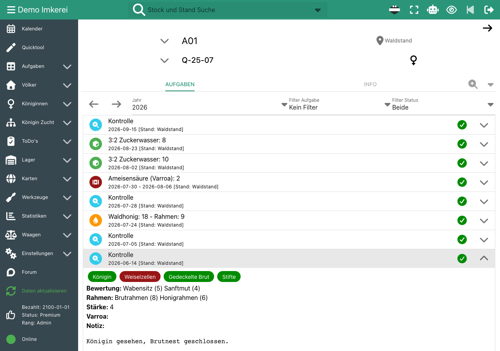
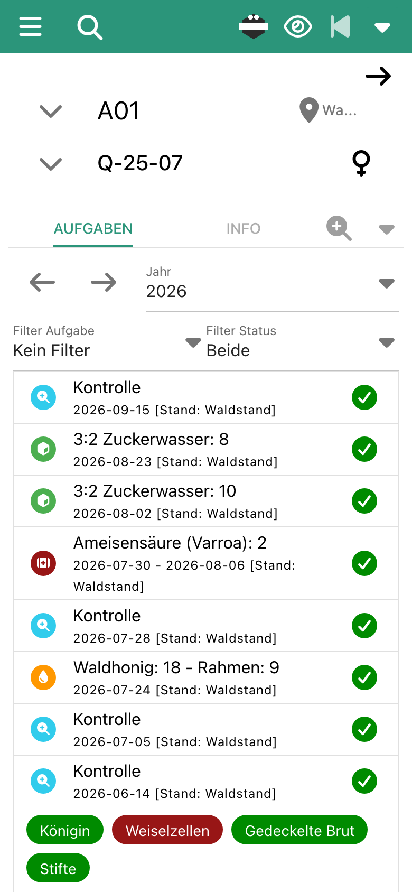
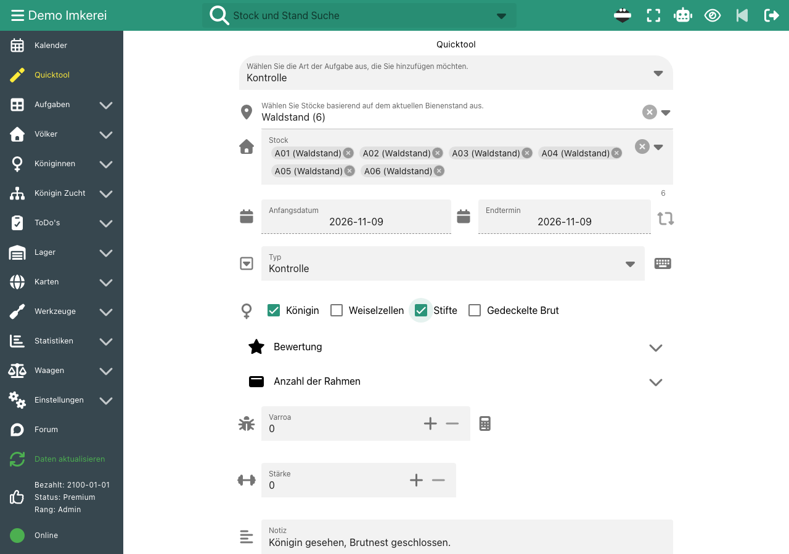
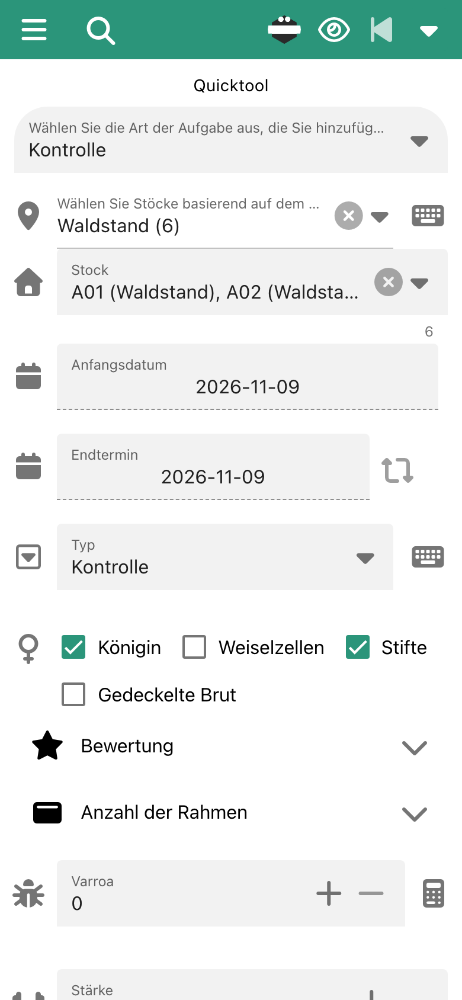
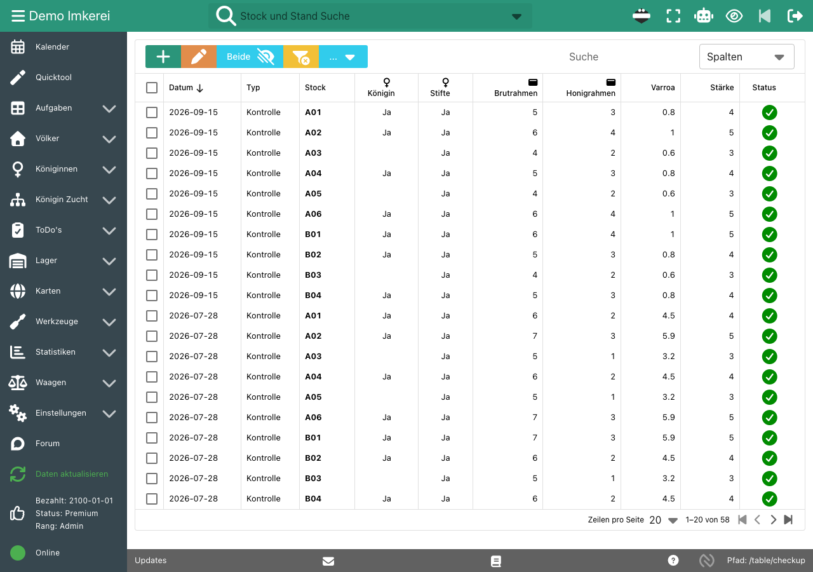

Stockkarten aus Papier bleiben am Stand, werden nass und lassen sich schwer vergleichen. Wann wurde das Volk zuletzt behandelt, wie stark war es im Frühjahr? Dafür blätterst du Karten durch. Bei vielen Völkern schreibst du dieselbe Notiz auf zehn Karten.

b.tree ist eine digitale Stockkarte für Imkerinnen und Imker, die am Stand schnell erfassen und am Schreibtisch alles wiederfinden wollen.

## So funktioniert es

- **Eine Seite pro Volk:** Die Stockseite zeigt alle Aufgaben eines Jahres mit Stand und aktueller Königin: Kontrollen, Fütterungen, Behandlungen und Ernten. Öffne einen Eintrag, um Details und Notizen zu sehen.
- **Schnell erfassen mit dem Quicktool:** Wähle einen Stand und b.tree wählt alle seine Völker aus. Ein Speichern erstellt für jedes Volk einen Eintrag. Bei Fütterungen, Behandlungen und Ernten kannst du eine Gesamtmenge eingeben, die b.tree auf die Völker aufteilt.
- **Deine eigenen Felder:** Du wählst, welche Felder das Kontrollformular zeigt, zum Beispiel Königin gesehen, Stifte, Weiselzellen, Bewertungen, Rahmen, Varroa und Stärke. Auch die Kontrolltypen legst du selbst fest.
- **Tabellen für viele Völker:** Alle Kontrollen deiner Imkerei stehen in einer Tabelle. Sortiere, filtere und vergleiche sie und exportiere sie als CSV.
- **Zum Ausdrucken:** Drucke für jedes Volk eine Jahresübersicht aller Aufgaben.
- **Am Stand:** b.tree läuft im Browser deines Handys und lässt sich als App installieren. QR-Codes und NFC-Tags (Android) öffnen die Seite eines Volkes direkt.

## Screenshots

Die Stockseite mit allen Aufgaben der Saison und einer geöffneten Kontrolle:

Das Quicktool: eine Kontrolle für alle sechs Völker eines Standes:

Alle Kontrollen in einer Tabelle, die neuesten zuerst:

## Dokumentation

- [Erste Schritte](/de/doc-first-steps/#neue-aufgaben--quicktool): Quicktool, Felder und Optionen
- [Stockdaten drucken](/de/doc-first-steps/#stockdaten-drucken)
- [Alle Funktionen](/de/features/)

## Häufige Fragen

### Ist die digitale Stockkarte kostenlos?

Ja. Der Basic-Tarif ist für bis zu 5 Völker und 2 Stände kostenlos. Premium kostet 55 € pro Jahr und erlaubt bis zu 1.000 Völker. Siehe [Preis](/de/price/).

### Kann ich die Stockkarte ausdrucken?

Ja. Öffne die Stockseite und verwende den Druck-Button. b.tree erstellt eine druckfreundliche Übersicht aller Aufgaben des Volkes für ein Jahr.

### Können mehrere Imker mit denselben Stockkarten arbeiten?

Ja. Füge in den Unternehmenseinstellungen weitere Benutzer zu deiner Imkerei hinzu. Jeder Benutzer hat den Rang Admin, User oder Read-Only. Premium zahlst du einmal pro Imkerei, nicht pro Benutzer.

### Funktioniert b.tree ohne Internetverbindung?

Nein. b.tree braucht eine Internetverbindung.

### Kann ich meine Stockkarten exportieren?

Ja. Du kannst die Tabellen als CSV exportieren und ein vollständiges Backup deiner Daten herunterladen.
