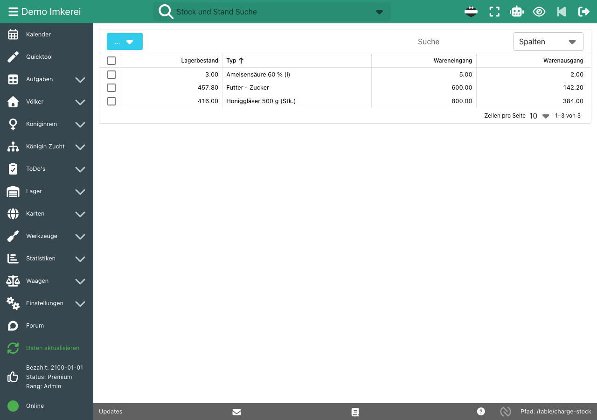
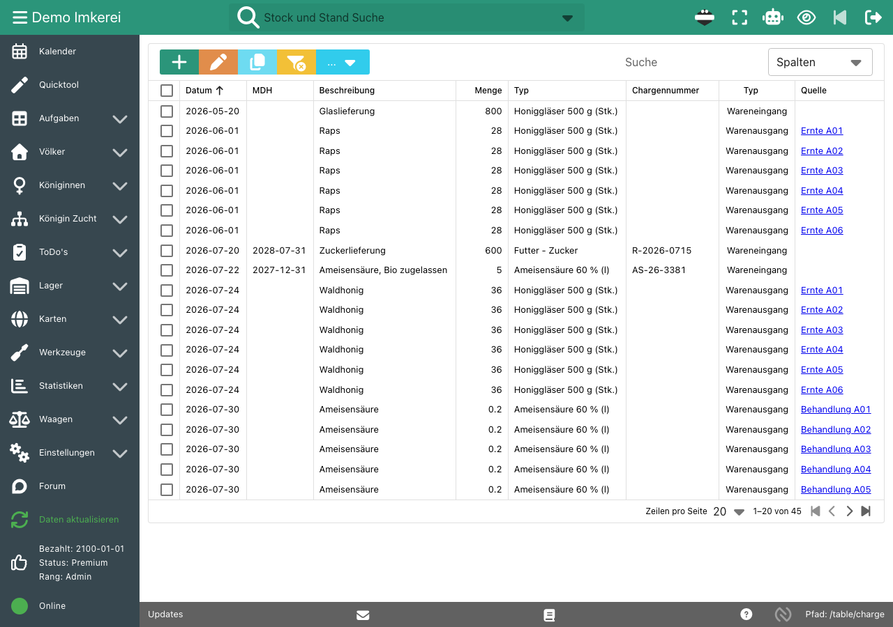
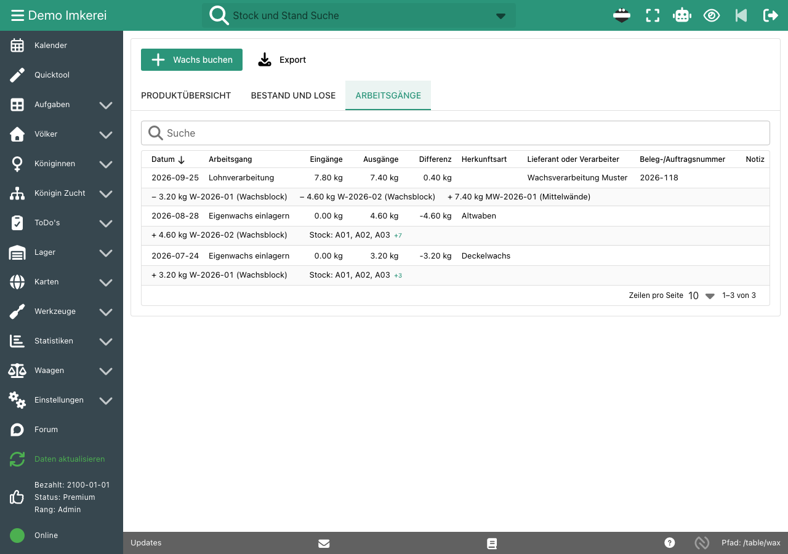

Bio-Imkereien dokumentieren ihren Warenfluss: was mit welcher Chargennummer hereingekommen ist, was in welches Volk gegangen ist und woher das Wachs stammt. Auf Papier müssen Lieferscheine, Stockkarten und Wachslisten zusammenpassen, und bei der Kontrolle suchst du das richtige Blatt.

Wir führen unsere eigene Bio-Dokumentation mit b.tree. Lager, Behandlungen, Fütterungen und Wachskreislauf sind verbunden, sodass ein Eintrag am Stand auch das Lager aktualisiert.

## So funktioniert es

- **Lager mit Chargennummern:** Buche jeden Wareneingang mit Chargennummer, Mindesthaltbarkeitsdatum, Preis und Notiz, zum Beispiel Zucker, Behandlungsmittel oder Honiggläser. Die Lagertabelle zeigt Lagerbestand, Wareneingang und Warenausgang.
- **Lagerbuchungen aus deinen Aufgaben:** Gib einer Fütterungs-, Behandlungs- oder Ernteart einen Lagerverbrauch, zum Beispiel 0,79 kg Zucker pro Liter 3:2-Zuckerwasser oder 0,2 l Ameisensäure pro Volk. Jede erledigte Aufgabe bucht ihre Lagerbuchung, und die Lagerbuchung verlinkt auf die Aufgabe und das Volk.
- **Inventur:** Zähle dein Lager und trage den gezählten Bestand als Inventur ein. b.tree bucht die Differenz.
- **Behandlungen und Fütterungen pro Volk:** Datum, Menge, Krankheit und Wartezeit werden für jedes Volk erfasst und auf seiner [digitalen Stockkarte](/de/features/hive-records/) angezeigt.
- **Wachskreislauf mit Losen:** Lagere Eigenwachs aus Deckelwachs oder Altwaben mit Herkunft und Herkunftsvölkern ein. Buche Verarbeitung oder Lohnverarbeitung zu Mittelwänden mit Verarbeiter und Auftragsnummer. b.tree berechnet den Verarbeitungsverlust. Fehler korrigierst du mit einer Gegenbuchung, statt sie zu löschen.
- **Export:** Exportiere die Lagerbuchungen und das vollständige Wachsjournal als CSV.

## Screenshots

Die Lagerübersicht mit Lagerbestand, Wareneingang und Warenausgang:

Lagerbuchungen: Lieferungen mit Chargennummer und MHD und die Buchungen aus Ernten und Behandlungen mit Link zum jeweiligen Volk:

Der Wachskreislauf: Eigenwachs aus zwei Ernten, von einem Lohnverarbeiter zu Mittelwänden verarbeitet:

## Dokumentation

- [Lager](/de/doc-first-steps/#lager): Lagerbuchungen, Lagerverbrauch und Inventur
- [Wachskreislauf](/de/doc-first-steps/#wachskreislauf): typischer Ablauf für Eigenwachs
- [Alle Funktionen](/de/features/)

## Häufige Fragen

### Ersetzt b.tree die Aufzeichnungen, die meine Bio-Kontrollstelle verlangt?

b.tree führt die Aufzeichnungen zu Warenfluss, Behandlungen und Wachslosen an einem Ort, und wir nutzen es für unsere eigene Bio-Zertifizierung. Welche Aufzeichnungen deine Kontrollstelle verlangt, hängt von der Kontrollstelle und vom Land ab. Frag deine Kontrollstelle, welche Aufzeichnungen sie braucht.

### Kann ich die Chargennummern von Zucker und Behandlungsmitteln erfassen?

Ja. Jeder Wareneingang hat eine Chargennummer und ein Mindesthaltbarkeitsdatum. Bei Zucker kannst du auch die Rechnungsnummer als Chargennummer eintragen.

### Wird das Lager beim Füttern automatisch gebucht?

Ja, wenn die Futterart einen Lagerverbrauch hat. Den Lagerverbrauch legst du in den Optionen für Futter-, Behandlungs- und Erntearten fest. Jede erledigte Aufgabe bucht dann ihre Lagerbuchung.

### Wie verfolge ich Wachs von der Wabe bis zur Mittelwand?

Jeder Wachsblock bekommt beim Einlagern eine Losnummer. Eine Verarbeitung bucht die Eingangslose aus und erstellt neue Ausgangslose, zum Beispiel Mittelwände. Die Tabelle der Arbeitsgänge zeigt, welche Lose in welches Produkt gegangen sind.

### Brauche ich Premium für Lager und Wachskreislauf?

Nein. Lager und Wachskreislauf sind im kostenlosen Basic-Tarif enthalten. Basic ist auf 5 Völker und 2 Stände begrenzt. Siehe [Preis](/de/price/).
