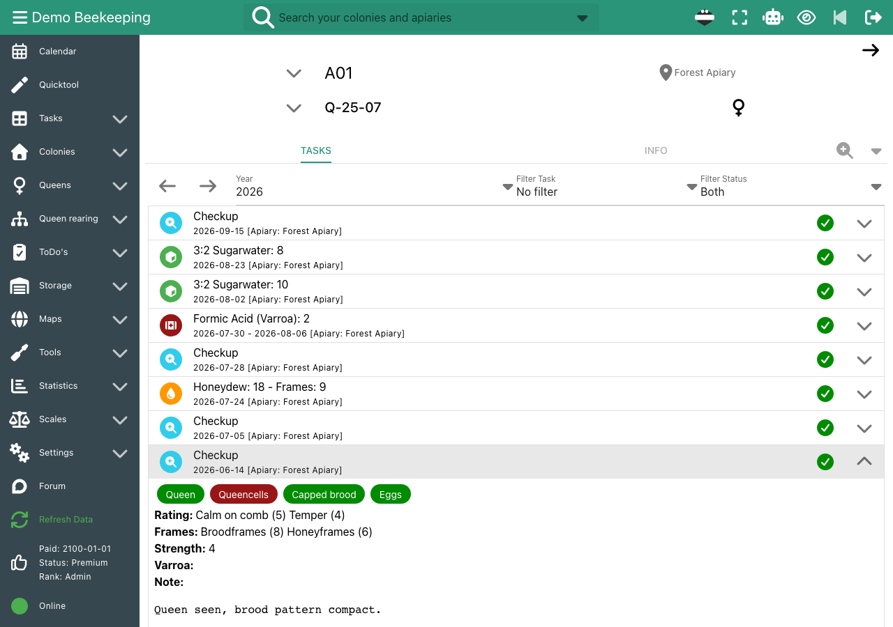
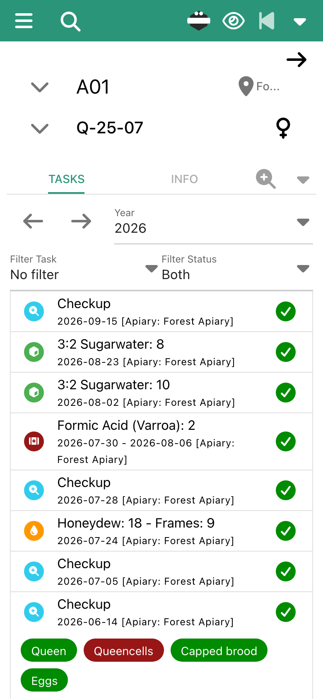
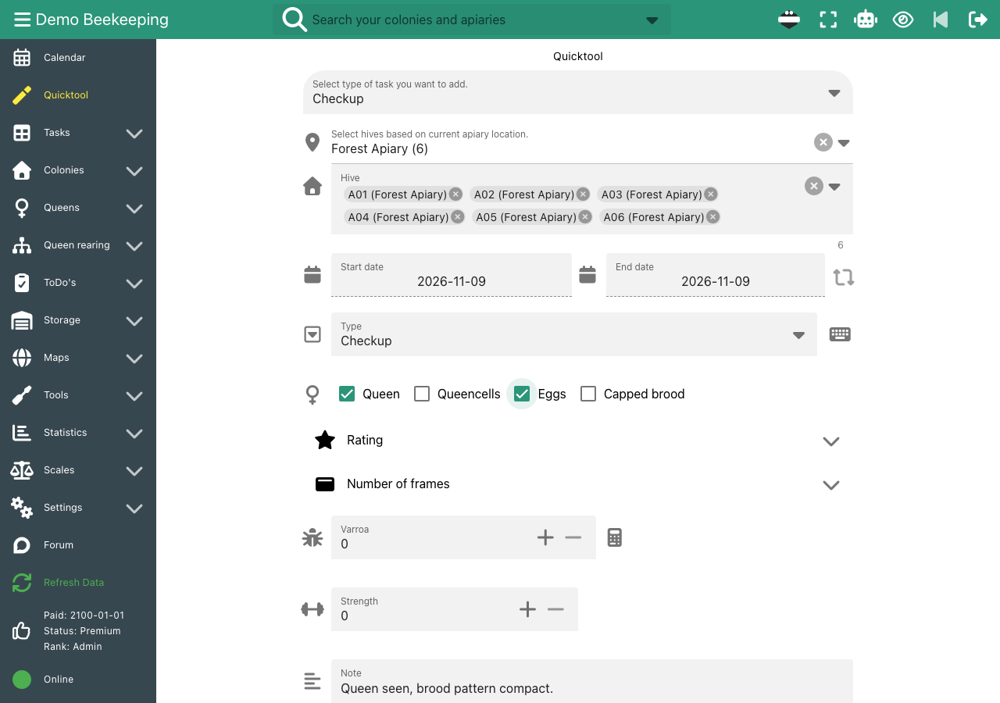
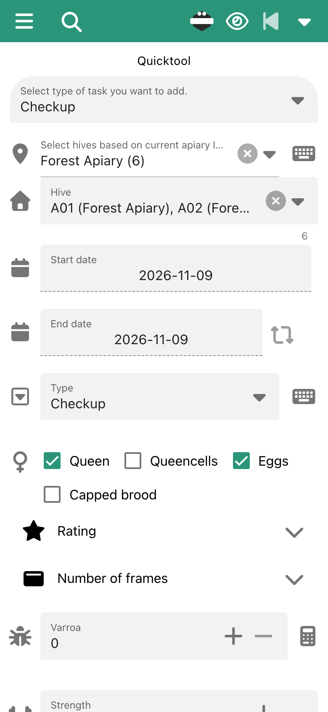
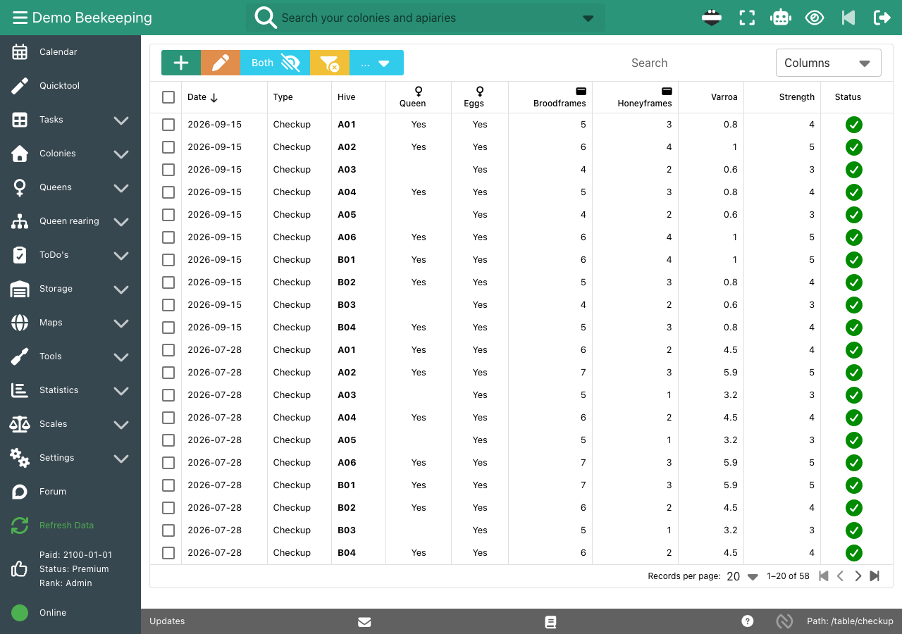

Paper hive records stay in the apiary, get wet and are hard to compare. To find out when a colony was treated last or how strong it was in spring, you leaf through cards. With many colonies, the same note goes on ten cards.

b.tree is a digital hive record for beekeepers who want to record fast in the apiary and find everything again at the desk.

## How it works

- **One page per hive:** The hive page shows all tasks of a year with the apiary and the current queen: inspections, feedings, treatments and harvests. Open an entry to see its details and notes.
- **Fast entry with the Quicktool:** Select an apiary and b.tree selects all its hives. One save creates one entry for each hive. For feedings, treatments and harvests, you can enter a total amount, and b.tree splits it across the hives.
- **Your own fields:** You choose which fields the inspection form shows, for example queen seen, eggs, queen cells, ratings, frames, varroa and strength. You also define your own inspection types.
- **Tables for many colonies:** All inspections of your operation are in one table. Sort, filter and compare them, and export them as CSV.
- **Printable:** Print a yearly overview of all tasks for each hive.
- **In the apiary:** b.tree runs in the browser of your phone and can be installed as an app. QR codes and NFC tags (Android) open the page of a hive directly.

## Screenshots

The hive page with all tasks of the season and one opened inspection:

The Quicktool: one inspection for all six hives of an apiary:

All inspections in one table, newest first:

## Documentation

- [First steps](/doc-first-steps/#new-tasks--quicktool): Quicktool, fields and options
- [Print hive records](/doc-first-steps/#print-hive-records)
- [All features](/features/)

## Frequently asked questions

### Is the digital hive record free?

Yes. The Basic plan is free for up to 5 hives and 2 apiaries. Premium costs 55 € per year and allows up to 1,000 hives. See [Price](/price/).

### Can I print my hive records?

Yes. Open the hive page and use the print button. b.tree creates a printer-friendly overview of all tasks of the colony for one year.

### Can several beekeepers work with the same hive records?

Yes. Add more users to your operation in the company settings. Each user has the rank Admin, User or Read-Only. Premium is paid once per operation, not per user.

### Does b.tree work without an internet connection?

No. b.tree needs an internet connection.

### Can I export my hive records?

Yes. You can export the tables as CSV and download a full backup of your data.
