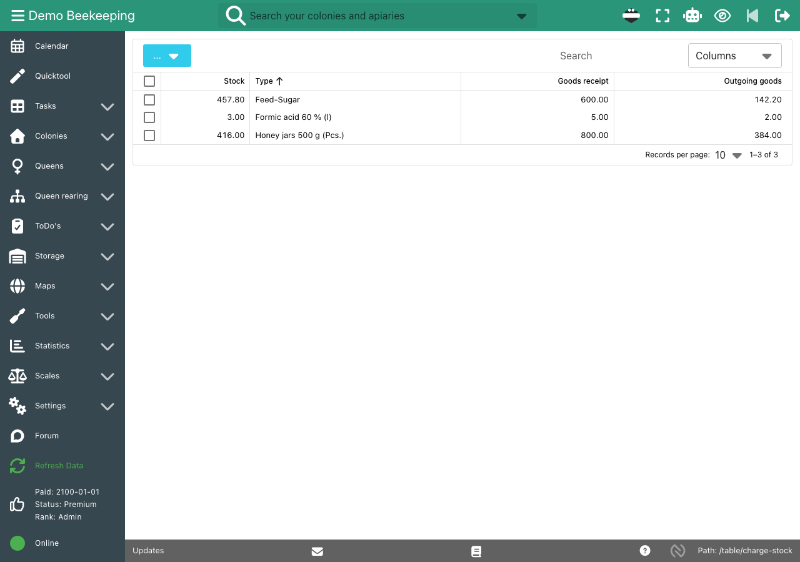
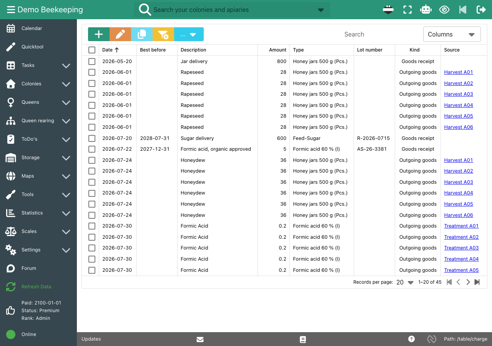
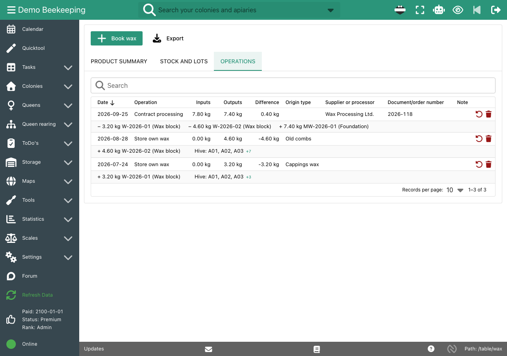

Organic beekeepers document their goods flow: what came in with which lot number, what went into which colony, and where the wax came from. On paper, delivery notes, hive cards and wax lists must agree, and at the inspection you search for the right sheet.

We keep our own organic beekeeping records with b.tree. Stock, treatments, feedings and the wax cycle are linked, so one entry in the apiary also updates the stock.

## How it works

- **Stock with lot numbers:** Book each goods receipt with lot number, best-before date, price and note, for example sugar, treatment agents or honey jars. The stock table shows the current stock, goods receipts and outgoing goods.
- **Stock movements from your tasks:** Give a feeding, treatment or harvest type a stock use, for example 0.79 kg sugar per liter of 3:2 sugar water or 0.2 l formic acid per hive. Each done task books its stock movement, and the movement links back to the task and the hive.
- **Inventory:** Count your storage and enter the counted total as an inventory. b.tree books the difference.
- **Treatments and feedings per hive:** Date, amount, disease and waiting time are recorded for each colony and shown on its [digital hive record](/features/hive-records/).
- **Wax cycle with lots:** Store own wax from cappings or old combs with origin and source colonies. Book processing or contract processing into foundation with the processor and the order number. b.tree calculates the processing loss. Mistakes are reversed with a correction entry, not deleted.
- **Export:** Export the stock movements and the complete wax ledger as CSV.

## Screenshots

The stock overview with current stock, goods receipts and outgoing goods:

Stock movements: deliveries with lot number and best-before date, and the bookings from harvests and treatments with a link to each hive:

The wax cycle: own wax from two harvests, processed into foundation by a contract processor:

## Documentation

- [Stock](/doc-first-steps/#stock): stock movements, stock use and inventory
- [Wax cycle](/doc-first-steps/#wax-cycle): typical workflow for own wax
- [All features](/features/)

## Frequently asked questions

### Does b.tree replace the records my organic control body asks for?

b.tree keeps the records of the goods flow, treatments and wax lots in one place, and we use it for our own organic certification. Which records your control body requires depends on the control body and the country. Ask your control body which records it needs.

### Can I record the lot numbers of sugar and treatment agents?

Yes. Each goods receipt has a lot number and a best-before date. For sugar, you can also enter the invoice number as the lot number.

### Is stock booked automatically when I feed?

Yes, if the feed type has a stock use. Set the stock use in the options for feed, treatment and harvest types. Each done task then books its stock movement.

### How do I trace wax from the comb to the foundation?

Each wax block gets a lot number when you store it. Processing books the input lots and creates new output lots, for example foundation. The operations table shows which lots went into which product.

### Do I need Premium for stock and the wax cycle?

No. Stock and the wax cycle are part of the free Basic plan. Basic is limited to 5 hives and 2 apiaries. See [Price](/price/).
